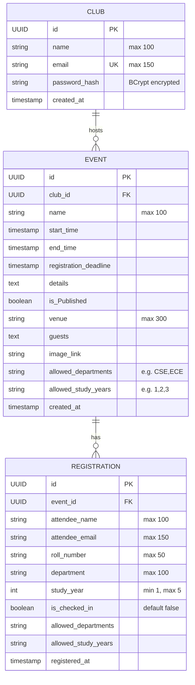
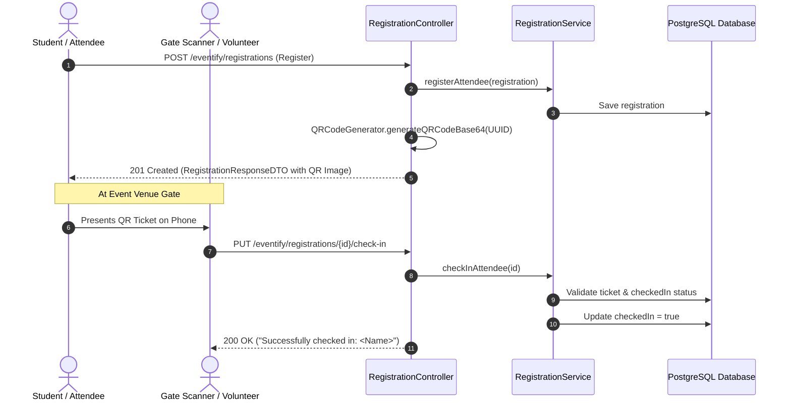

# Eventify 🎟️

Eventify is a robust backend REST API built with **Spring Boot** and **PostgreSQL**, designed to manage college/organization clubs, event publishing, attendee registrations, automated QR code ticketing, door/gate check-ins, and secure club authentication using JWT.

---

## 📑 Table of Contents
- [Tech Stack](#tech-stack)
- [Architecture & Package Structure](#architecture--package-structure)
- [Entity-Relationship Diagram](#entity-relationship-diagram)
- [Database Configuration](#database-configuration)
- [2nd Part of Development: Authentication, Security & DTO Architecture](#2nd-part-of-development)
  - [1. Overview of 2nd Part Changes](#1-overview-of-2nd-part-changes)
  - [2. JWT Authentication & Filter Pipeline](#2-jwt-authentication--filter-pipeline)
  - [3. Password Encryption (BCrypt)](#3-password-encryption-bcrypt)
  - [4. Data Transfer Objects (DTO) Pattern](#4-data-transfer-objects-dto-pattern)
  - [5. Centralized Error Handling (`GlobalExceptionHandler`)](#5-centralized-error-handling-globalexceptionhandler)
  - [6. Route Authorization Matrix (Public vs Protected)](#6-route-authorization-matrix-public-vs-protected)
- [3rd Part of Development: QR Code Ticketing, Gate Check-in & Input Validation](#3rd-part-of-development)
  - [1. Overview of 3rd Part Changes](#1-overview-of-3rd-part-changes)
  - [2. Dynamic QR Code Generation (ZXing Engine)](#2-dynamic-qr-code-generation-zxing-engine)
  - [3. Ticket Response Model (`RegistrationResponseDTO`)](#3-ticket-response-model-registrationresponsedto)
  - [4. Fast Gate Check-in Flow & Security Exemption](#4-fast-gate-check-in-flow--security-exemption)
  - [5. Double Check-in Prevention](#5-double-check-in-prevention)
  - [6. Input Validation & DTO Hygiene (`ClubRequestDTO`)](#6-input-validation--dto-hygiene-clubrequestdto)
  - [7. Validation Exception Handling](#7-validation-exception-handling)
- [API Reference](#api-reference)
  - [Authentication Endpoints](#1-authentication-endpoints)
  - [Club Endpoints](#2-club-endpoints)
  - [Event Endpoints](#3-event-endpoints)
  - [Registration & Ticketing Endpoints](#4-registration--ticketing-endpoints)
- [Eligibility & Validation Rules](#eligibility--validation-rules)
- [Getting Started & Testing with JWT & QR](#getting-started--testing-with-jwt--qr)

---

## 🛠️ Tech Stack

- **Java**: 27
- **Framework**: Spring Boot 4.x / Spring Data JPA / Spring MVC
- **Security**: Spring Security 6.x & `BCryptPasswordEncoder`
- **Authentication**: JJWT (Java JWT `io.jsonwebtoken:jjwt-api:0.12.6`, `jjwt-impl`, `jjwt-jackson`)
- **QR Code Engine**: Google ZXing (`com.google.zxing:core:3.5.3`, `com.google.zxing:javase:3.5.3`)
- **Database**: PostgreSQL
- **ORM / Persistence**: Hibernate / Jakarta Persistence (JPA)
- **Validation**: Jakarta Bean Validation (`hibernate-validator` / `spring-boot-starter-validation`)
- **Boilerplate Reduction**: Project Lombok
- **Build Tool**: Maven (`mvnw`)

---

## 📂 Architecture & Package Structure

The project follows a standard layered architecture under `me.geetprince.Eventify`:

```
src/main/java/me/geetprince/Eventify/
├── EventifyApplication.java           # Application entry point
├── config/
│   ├── CorsConfig.java                # Cross-Origin Resource Sharing configuration
│   ├── JwtAuthenticationFilter.java   # [Part 2] Intercepts requests & validates Bearer tokens
│   └── SecurityConfig.java            # [Part 2 & 3] Route security, filter order, public check-in
├── controller/
│   ├── AuthController.java            # [Part 2] REST endpoints for Club login & JWT issuance
│   ├── ClubController.java            # [Part 2 & 3] REST endpoints for Club registration & queries
│   ├── EventController.java           # REST endpoints for Event CRUD operations
│   └── RegistrationController.java    # [Part 3] QR ticket generation & public gate check-ins
├── dto/                               # Data Transfer Objects
│   ├── ClubRequestDTO.java            # [Part 3] Validated payload for club registration
│   ├── ClubResponseDTO.java           # [Part 2] Sanitized Club response (password omitted)
│   ├── ErrorResponse.java             # [Part 2] Structured error payload model
│   ├── LoginRequest.java              # [Part 2] Request body schema for login credentials
│   └── RegistrationResponseDTO.java   # [Part 3] Ticket response containing Base64 QR code image
├── exception/                         # Centralized exception handling
│   └── GlobalExceptionHandler.java    # [Part 2 & 3] @ControllerAdvice handling business & validation errors
├── model/
│   ├── Club.java                      # Club JPA entity (organizers)
│   ├── Event.java                     # Event JPA entity (events hosted by clubs)
│   └── Registration.java              # Registration JPA entity (attendees)
├── repository/
│   ├── ClubRepository.java            # Spring Data JPA repository for Club
│   ├── EventRepository.java           # Spring Data JPA repository for Event
│   └── RegistrationRepository.java    # Spring Data JPA repository for Registration
├── service/
│   ├── ClubService.java               # Business logic, BCrypt hashing & login verification
│   ├── EventService.java              # Business logic & queries for Events
│   └── RegistrationService.java       # [Part 3] Eligibility logic, QR ticket checks, check-ins & CSV export
└── util/                              # Utility helpers
    ├── CSVExportUtil.java             # [Part 3] Dynamic CSV export generator with special char escaping
    ├── JwtUtil.java                   # [Part 2] JWT creation, claims extraction & validation
    └── QRCodeGenerator.java           # [Part 3] Base64 250x250 PNG QR code generator via ZXing
```

---

## 📊 Entity-Relationship Diagram



---

## ⚙️ Database Configuration

Configuration resides in [`src/main/resources/application.properties`](file:///Users/geet/projects/converting%20form%20py%20to%20java/Eventify/src/main/resources/application.properties):

```properties
spring.application.name=Eventify
spring.datasource.url=jdbc:postgresql://localhost:5432/eventify
spring.datasource.username=geet
spring.datasource.password=0
spring.datasource.driver-class-name=org.postgresql.Driver

spring.jpa.hibernate.ddl-auto=update
spring.jpa.show-sql=true
logging.level.org.springframework.security=DEBUG
```

Ensure your PostgreSQL instance is running with a database named `eventify`.

---

<a name="2nd-part-of-development"></a>
## 🚀 2nd Part of Development: Authentication, Security & DTO Architecture

In the **2nd Part of Development**, the application transitioned from an open prototype to an industry-grade, secure, multi-tenant REST API with token-based stateless authentication, password security, DTO data hygiene, and global exception interception.

### 1. Overview of 2nd Part Changes

| Area | Prior Implementation (Phase 1) | 2nd Part Implementation (Phase 2) |
|---|---|---|
| **Authentication** | None (All endpoints unprotected) | **Stateless JWT Authentication** with token signing, extraction, and validation |
| **Password Storage** | Plain text / unverified hashes | **BCrypt hashing** (`BCryptPasswordEncoder`) on club registration and matching on login |
| **Data Hygiene** | Raw JPA entities returned in API responses | **Data Transfer Objects (DTOs)** (`ClubResponseDTO`) masking sensitive fields like `passwordHash` |
| **Error Handling** | Scattered manual `try-catch` blocks in controllers | **Centralized `@ControllerAdvice`** (`GlobalExceptionHandler`) with standardized schema |
| **Route Security** | Blanket permit on `/eventify/**` | **Fine-grained RBAC**: Public event browsing & student registration; protected event management |
| **Club Operations** | Only `POST /register` | Added `GET /eventify/clubs/{id}` and `GET /eventify/clubs` returning sanitized DTOs |

---

### 2. JWT Authentication & Filter Pipeline

#### Token Generation & Specifications
- **Signing Algorithm**: HMAC-SHA256 (`HS256`) via JJWT (`io.jsonwebtoken:jjwt-api:0.12.6`).
- **Expiration**: 24 hours (`86,400,000` milliseconds).
- **Subject**: Club's unique email address.
- **Component**: [`JwtUtil.java`](file:///Users/geet/projects/converting%20form%20py%20to%20java/Eventify/src/main/java/me/geetprince/Eventify/util/JwtUtil.java).

#### Filter Chain Pipeline
1. Incoming requests pass through [`JwtAuthenticationFilter.java`](file:///Users/geet/projects/converting%20form%20py%20to%20java/Eventify/src/main/java/me/geetprince/Eventify/config/JwtAuthenticationFilter.java) (extending `OncePerRequestFilter`).
2. The filter inspects the HTTP `Authorization` header for `Bearer <token>`.
3. If present and valid, the club email is extracted from the JWT claims.
4. An authenticated `UsernamePasswordAuthenticationToken` is set into Spring's `SecurityContextHolder`.
5. If absent on protected routes, Spring Security blocks the request with `403 Forbidden` / `401 Unauthorized`.

---

### 3. Password Encryption (BCrypt)

- Registered [`PasswordEncoder`](file:///Users/geet/projects/converting%20form%20py%20to%20java/Eventify/src/main/java/me/geetprince/Eventify/config/SecurityConfig.java) bean using `BCryptPasswordEncoder`.
- **Registration**: When a club registers (`ClubService.registerClub`), raw passwords are encrypted with `passwordEncoder.encode(...)` before being persisted to PostgreSQL.
- **Login**: When logging in (`ClubService.verifyLogin`), input passwords are authenticated using `passwordEncoder.matches(...)`. Invalid credentials throw an `IllegalArgumentException("Invalid email or password.")`.

---

### 4. Data Transfer Objects (DTO) Pattern

- **`ClubResponseDTO`**: Sanitized club object omitting `passwordHash`.
- **`LoginRequest`**: Request payload schema for `{ email, password }`.
- **`ErrorResponse`**: Standardized JSON schema for errors `{ status, error, message, timestamp }`.

---

### 5. Centralized Error Handling (`GlobalExceptionHandler`)

Implemented via [`@ControllerAdvice`](file:///Users/geet/projects/converting%20form%20py%20to%20java/Eventify/src/main/java/me/geetprince/Eventify/exception/GlobalExceptionHandler.java):
- **`IllegalArgumentException`**: Automatically mapped to `400 Bad Request` with structured `ErrorResponse`.
- **`Exception` (General fallback)**: Automatically mapped to `500 Internal Server Error` with a safe message.

---

### 6. Route Authorization Matrix (Public vs Protected)

| Method | Endpoint | Access Level | Description |
|---|---|---|---|
| `POST` | `/eventify/auth/login` | 🌐 **Public** | Authenticate club & issue JWT token |
| `POST` | `/eventify/auth/register` | 🌐 **Public** | Register new club account via Auth route |
| `POST` | `/eventify/clubs/register` | 🌐 **Public** | Register new club account via Clubs route |
| `GET` | `/eventify/clubs/{id}` | 🌐 **Public** | Fetch sanitized club profile |
| `GET` | `/eventify/clubs` | 🌐 **Public** | Fetch all registered clubs |
| `GET` | `/eventify/events` | 🌐 **Public** | List all events for attendees/public |
| `GET` | `/eventify/events/{id}` | 🌐 **Public** | View specific event details |
| `POST` | `/eventify/registrations` | 🌐 **Public** | Attendees register & receive QR ticket |
| `PUT` | `/eventify/registrations/*/check-in` | 🌐 **Public** | Gate security scans ticket QR code |
| `GET` | `/eventify/registrations/event/*/export` | 🌐 **Public** | Download filtered attendance report as CSV |
| `POST` | `/eventify/events` | 🔒 **Protected** (Bearer JWT) | Create a new event (Clubs only) |
| `PUT` | `/eventify/events/{id}` | 🔒 **Protected** (Bearer JWT) | Update an event (Clubs only) |
| `GET` | `/eventify/registrations/event/{eventId}` | 🔒 **Protected** (Bearer JWT) | View attendee list for an event |

---

<a name="3rd-part-of-development"></a>
## 🎫 3rd Part of Development: QR Code Ticketing, Gate Check-in & Input Validation

The **3rd Part of Development** introduced dynamic QR code ticket generation, high-speed gate check-in workflows, double check-in prevention, and bean input validation.

### 1. Overview of 3rd Part Changes

| Component / Feature | Description | Impact |
|---|---|---|
| **Google ZXing Engine** | Integrated `com.google.zxing:core:3.5.3` & `javase:3.5.3` | Enables in-memory 2D barcode / QR generation without external third-party services |
| **`QRCodeGenerator` Utility** | Converts ticket UUIDs into 250x250 PNG QR code images | Returns Base64 strings for direct frontend `` embedding |
| **`RegistrationResponseDTO`** | Replaced raw entity return on registration | Delivers ticket details along with `qrCodeBase64` image string |
| **Fast Gate Check-in** | `PUT /eventify/registrations/{id}/check-in` made public | Gate staff/volunteers can scan QR codes instantly without needing admin login |
| **Double Check-in Guard** | Added check in `RegistrationService.checkInAttendee` | Rejects duplicate ticket entries with `"Attendee has already checked in!"` |
| **`ClubRequestDTO` Validation** | Added Bean Validation (`@NotBlank`, `@Email`, `@Size`) | Enforces valid names (min 3 chars), email format, and passwords (min 6 chars) |
| **Validation Exception Interceptor** | Added `MethodArgumentNotValidException` handler | Returns clean `400 Bad Request` with field-level validation messages |
| **Filtered CSV Attendance Export** | `GET /eventify/registrations/event/{eventId}/export` | Streams custom CSV download filtered by department, study year, and check-in status |

---

### 2. Dynamic QR Code Generation (ZXing Engine)

Implemented in [`QRCodeGenerator.java`](file:///Users/geet/projects/converting%20form%20py%20to%20java/Eventify/src/main/java/me/geetprince/Eventify/util/QRCodeGenerator.java):
```java
public class QRCodeGenerator {
    public static String generateQRCodeBase64(String text) {
        QRCodeWriter qrCodeWriter = new QRCodeWriter();
        BitMatrix bitMatrix = qrCodeWriter.encode(text, BarcodeFormat.QR_CODE, 250, 250);
        ByteArrayOutputStream outputStream = new ByteArrayOutputStream();
        MatrixToImageWriter.writeToStream(bitMatrix, "PNG", outputStream);
        return Base64.getEncoder().encodeToString(outputStream.toByteArray());
    }
}
```
- **Image Size**: 250 x 250 pixels.
- **Output**: Base64 encoded PNG string.
- **Payload**: The unique `UUID` of the registration ticket.
- **Frontend Display**: Directly renderable in HTML/React via:
  ```html
  
  ```

---

### 3. Ticket Response Model (`RegistrationResponseDTO`)

When a student registers, [`RegistrationController`](file:///Users/geet/projects/converting%20form%20py%20to%20java/Eventify/src/main/java/me/geetprince/Eventify/controller/RegistrationController.java) packages the ticket into a [`RegistrationResponseDTO`](file:///Users/geet/projects/converting%20form%20py%20to%20java/Eventify/src/main/java/me/geetprince/Eventify/dto/RegistrationResponseDTO.java):

```json
{
  "id": "c86e082d-2092-4fcf-847d-8ebff82895ea",
  "studentName": "Alex Johnson",
  "studentEmail": "alex.johnson@university.edu",
  "checkedIn": false,
  "qrCodeBase64": "iVBORw0KGgoAAAANSUhEUgAAAPAAAADwCAYAAAA+VemSAAAAAXNSR0IArs4c6QAAA..."
}
```

---

### 4. Fast Gate Check-in Flow & Security Exemption

Gate security staff or automated scanner devices at event venue entrances scan attendee tickets to verify admittance:
1. **QR Code Scanning**: The scanner reads the registration `UUID` encoded in the QR image.
2. **Hit Check-in API**: Sends a `PUT /eventify/registrations/{id}/check-in` request.
3. **Public Gate Exemption**: Updated in [`SecurityConfig.java`](file:///Users/geet/projects/converting%20form%20py%20to%20java/Eventify/src/main/java/me/geetprince/Eventify/config/SecurityConfig.java) to allow gate personnel to perform check-ins without entering club credentials:
   ```java
   .requestMatchers(HttpMethod.PUT, "/eventify/registrations/*/check-in").permitAll()
   ```



---

### 5. Double Check-in Prevention

In [`RegistrationService.java`](file:///Users/geet/projects/converting%20form%20py%20to%20java/Eventify/src/main/java/me/geetprince/Eventify/service/RegistrationService.java):
```java
public Registration checkInAttendee(UUID registrationId) {
    Registration registration = registrationRepo.findById(registrationId)
            .orElseThrow(() -> new IllegalArgumentException("Registration ticket not found!"));

    if (registration.getCheckedIn()) {
        throw new IllegalArgumentException("Attendee has already checked in!");
    }
    registration.setCheckedIn(true);
    return registrationRepo.save(registration);
}
```
- If a ticket has already been used to enter, subsequent scans are immediately rejected with `400 Bad Request` (`"Attendee has already checked in!"`), preventing ticket pass-backs or duplicate admittance.

---

### 6. Input Validation & DTO Hygiene (`ClubRequestDTO`)

Club registration inputs are now validated before reaching service logic using [`ClubRequestDTO`](file:///Users/geet/projects/converting%20form%20py%20to%20java/Eventify/src/main/java/me/geetprince/Eventify/dto/ClubRequestDTO.java):
- **`name`**: `@NotBlank(message = "Club name is required")`, `@Size(min = 3, message = "Club name must be at least 3 characters long")`
- **`email`**: `@NotBlank(message = "Email is required")`, `@Email(message = "Please provide a valid email format")`
- **`password`**: `@NotBlank(message = "Password is required")`, `@Size(min = 6, message = "Password must be at least 6 characters long")`

---

### 7. Validation Exception Handling

Added to [`GlobalExceptionHandler.java`](file:///Users/geet/projects/converting%20form%20py%20to%20java/Eventify/src/main/java/me/geetprince/Eventify/exception/GlobalExceptionHandler.java):
```java
@ExceptionHandler(MethodArgumentNotValidException.class)
public ResponseEntity<ErrorResponse> handleValidationExceptions(MethodArgumentNotValidException ex) {
    String errorMessage = ex.getBindingResult().getFieldErrors().get(0).getDefaultMessage();
    ErrorResponse error = new ErrorResponse(
            HttpStatus.BAD_REQUEST.value(),
            "Validation Failed",
            errorMessage
    );
    return new ResponseEntity<>(error, HttpStatus.BAD_REQUEST);
}
```
If a client submits an invalid registration payload, they receive:
```json
{
  "status": 400,
  "error": "Validation Failed",
  "message": "Password must be at least 6 characters long",
  "timestamp": "2026-11-05T07:30:00"
}
```

---

### 8. Dynamic CSV Attendance Export

Implemented via [`CSVExportUtil.java`](file:///Users/geet/projects/converting%20form%20py%20to%20java/Eventify/src/main/java/me/geetprince/Eventify/util/CSVExportUtil.java):
- **Features**:
  - Dynamically filters registrations using Java 16+ streams based on query params (`department`, `studyYear`, `checkedIn`).
  - Escapes special characters (quotes, commas, line breaks) to guarantee standard RFC 4180 CSV compliance.
  - Automatically formats the HTTP header with `Content-Disposition: attachment; filename="event_<eventId>_attendance.csv"`.
- **Columns**: `Name,Email,Roll Number,Department,Study Year,Checked In,Registration Date`.

---

## 🚀 API Reference

Base URL: `http://localhost:8080`

### 1. Authentication Endpoints

#### Club Login
* **Method & URL**: `POST /eventify/auth/login`
* **Access**: 🌐 Public
* **Request Body**:
```json
{
  "email": "codingclub@university.edu",
  "password": "SecurePassword123!"
}
```
* **Success Response**: `200 OK`
```json
{
  "token": "eyJhbGciOiJIUzI1NiJ9.eyJzdWIiOiJjb2RpbmdjbHViQHVuaXZlcnNpdHkuZWR1IiwiaWF0IjoxNzYzMTk2MDAwLCJleHAiOjE3NjMyODI0MDB9...",
  "clubId": "e6f4a86b-a25e-4c74-8dbb-91d9b32c63df"
}
```
* **Error Response**: `401 Unauthorized`

#### Club Signup / Registration (Auth Endpoint)
* **Method & URL**: `POST /eventify/auth/register` (also supported on `/eventify/clubs/register`)
* **Access**: 🌐 Public
* **Description**: Registers a new club organizer account with BCrypt password encryption and input validation.
* **Request Body** (`ClubRequestDTO`):
```json
{
  "name": "Developers Club",
  "email": "devs@university.edu",
  "password": "StrongPassword123!"
}
```
* **Success Response**: `201 Created` (`ClubResponseDTO`)
```json
{
  "id": "7b8d424b-324e-4b62-959c-7cf05efbe41e",
  "name": "Developers Club",
  "email": "devs@university.edu"
}
```
* **Error Response**: `400 Bad Request` with `ErrorResponse` model if validation fails or email already registered.

---

### 2. Club Endpoints

#### Register a Club
* **Method & URL**: `POST /eventify/clubs/register`
* **Access**: 🌐 Public
* **Validation Rules**:
  - `name`: Not blank, minimum 3 characters
  - `email`: Not blank, valid email format
  - `password`: Not blank, minimum 6 characters
* **Request Body** (`ClubRequestDTO`):
```json
{
  "name": "Robotics Club",
  "email": "robotics@university.edu",
  "password": "StrongPassword2026!"
}
```
* **Success Response**: `201 Created` (`ClubResponseDTO`)
```json
{
  "id": "7b8d424b-324e-4b62-959c-7cf05efbe41e",
  "name": "Robotics Club",
  "email": "robotics@university.edu"
}
```
* **Error Response**: `400 Bad Request` with `ErrorResponse` model.

#### Get Club by ID
* **Method & URL**: `GET /eventify/clubs/{id}`
* **Access**: 🌐 Public
* **Success Response**: `200 OK` with `ClubResponseDTO`.

#### Get All Clubs
* **Method & URL**: `GET /eventify/clubs`
* **Access**: 🌐 Public
* **Success Response**: `200 OK` with list of `ClubResponseDTO`.

---

### 3. Event Endpoints

#### Create an Event
* **Method & URL**: `POST /eventify/events`
* **Access**: 🔒 **Protected** (Requires `Authorization: Bearer <jwt_token>`)
* **Request Body**:
```json
{
  "name": "Annual Hackathon 2026",
  "club": {
    "id": "7b8d424b-324e-4b62-959c-7cf05efbe41e"
  },
  "startTime": "2026-12-10T10:00:00Z",
  "endTime": "2026-12-11T18:00:00Z",
  "registrationDeadline": "2026-12-05T23:59:59Z",
  "details": "24-hour coding marathon building real-world solutions.",
  "public": true,
  "venue": "Campus Auditorium & Labs",
  "guests": "Dr. Tech, Industry Experts",
  "imageLink": "https://example.com/banner.jpg",
  "allowedDepartments": "CSE,IT,ECE",
  "allowedStudyYears": "2,3,4"
}
```
* **Success Response**: `201 Created` with saved Event object.

#### Get All Events (Public Feed)
* **Method & URL**: `GET /eventify/events`
* **Access**: 🌐 Public
* **Description**: Returns all published events (`isPublic: true`).
* **Success Response**: `200 OK` with list of `EventResponseDTO`.

#### Get My Club's Events (Dashboard: Drafts & Published)
* **Method & URL**: `GET /eventify/events/my-events`
* **Access**: 🔒 **Protected** (Requires `Authorization: Bearer <jwt_token>`)
* **Description**: Returns all events belonging to the authenticated club, including drafts (`isPublic: false`) and published events.
* **Success Response**: `200 OK` with list of `EventResponseDTO`.

#### Publish / Unpublish Event (Toggle)
* **Method & URL**: `PATCH /eventify/events/{id}/publish?isPublic=true`
* **Access**: 🔒 **Protected** (Requires `Authorization: Bearer <jwt_token>`)
* **Description**: One-click toggle allowing a club to publish a draft or unpublish an event.
* **Success Response**: `200 OK` with updated `EventResponseDTO`.

#### Get Event by ID
* **Method & URL**: `GET /eventify/events/{id}`
* **Access**: 🌐 Public
* **Success Response**: `200 OK` with Event details.

#### Update Event
* **Method & URL**: `PUT /eventify/events/{id}`
* **Access**: 🔒 **Protected** (Requires `Authorization: Bearer <jwt_token>`)
* **Success Response**: `200 OK` with updated Event.

#### Delete Event
* **Method & URL**: `DELETE /eventify/events/{id}`
* **Access**: 🔒 **Protected** (Requires `Authorization: Bearer <jwt_token>`)
* **Success Response**: `204 No Content`.

---

### 4. Registration & Ticketing Endpoints

#### Register Attendee for an Event (Generates QR Ticket)
* **Method & URL**: `POST /eventify/registrations`
* **Access**: 🌐 Public
* **Description**: Registers attendee, validates department/year eligibility and duplicate registration, generates 250x250 PNG QR code, and returns ticket DTO.
* **Request Body**:
```json
{
  "event": {
    "id": "4a737f22-2615-4ba8-be9c-7bfaf565ecbe"
  },
  "attendeeName": "Alex Johnson",
  "attendeeEmail": "alex.johnson@university.edu",
  "rollNumber": "CS2023045",
  "department": "CSE",
  "studyYear": 3
}
```
* **Success Response**: `201 Created` (`RegistrationResponseDTO`)
```json
{
  "id": "c86e082d-2092-4fcf-847d-8ebff82895ea",
  "studentName": "Alex Johnson",
  "studentEmail": "alex.johnson@university.edu",
  "checkedIn": false,
  "qrCodeBase64": "iVBORw0KGgoAAAANSUhEUgAAAPAAAADwCAYAAAA+VemSAAAAAXNSR0IArs4c6QAAA..."
}
```
* **Error Responses** (`400 Bad Request`):
  - `"Your department is not eligible for this event."`
  - `"Your study year is not eligible for this event."`
  - `"Already registered for this event."`
  - `"Event not found."`

#### Gate Check-in Attendee via QR Ticket
* **Method & URL**: `PUT /eventify/registrations/{id}/check-in`
* **Access**: 🌐 Public (Fast Gate Scanner Access)
* **Path Variables**: `id` (UUID) - Ticket / Registration UUID decoded from QR Code
* **Success Response**: `200 OK`
```text
Successfully checked in: Alex Johnson
```
* **Error Responses** (`400 Bad Request`):
  - `"Registration ticket not found!"` (Invalid ticket)
  - `"Attendee has already checked in!"` (Double check-in prevented)

#### Get All Registrations for an Event
* **Method & URL**: `GET /eventify/registrations/event/{eventId}`
* **Access**: 🔒 **Protected** (Requires `Authorization: Bearer <jwt_token>`)
* **Success Response**: `200 OK` with list of registrations.

#### Export Registrations to CSV
* **Method & URL**: `GET /eventify/registrations/event/{eventId}/export`
* **Access**: 🌐 Public
* **Query Parameters** (All optional):
  - `department` (String) - e.g. `CSE`
  - `studyYear` (Integer) - e.g. `3`
  - `checkedIn` (Boolean) - `true` or `false`
* **Headers in Response**:
  - `Content-Type: text/csv`
  - `Content-Disposition: attachment; filename="event_<eventId>_attendance.csv"`
* **Example Usage**:
  ```bash
  curl -O "http://localhost:8080/eventify/registrations/event/<EVENT_ID>/export?department=CSE&checkedIn=true"
  ```
* **Success Response**: `200 OK` (Streams CSV file)
```csv
Name,Email,Roll Number,Department,Study Year,Checked In,Registration Date
Alex Johnson,alex.johnson@university.edu,CS2023045,CSE,3,Yes,2026-11-05T04:40:00Z
```

---

## 🔒 Eligibility & Validation Rules

1. **Department Restriction (`allowedDepartments`)**:
   - If populated on the event (e.g. `"CSE,IT"`), registration verifies the student's department against this comma-delimited list (case-insensitive).
   - Ineligible departments receive `400 Bad Request`.
2. **Study Year Restriction (`allowedStudyYears`)**:
   - If populated on the event (e.g. `"2,3"`), registration checks `studyYear`.
   - Ineligible years receive `400 Bad Request`.
3. **Duplicate Prevention**:
   - Each attendee email can only register once per event (`existsByEvent_IdAndAttendeeEmail`).
4. **Validation Constraints**:
   - Attendee study year must be between `1` and `5` (`@Min(1)`, `@Max(5)`).
   - Club registration fields verified with `@NotBlank`, `@Email`, and `@Size`.

---

## 💻 Getting Started & Testing with JWT & QR

### 1. Prerequisites
- Java 27 SDK installed
- PostgreSQL running on port 5432 with database `eventify`
- Maven (`./mvnw`)

### 2. Run the Application
```bash
./mvnw clean spring-boot:run
```

### 3. Step-by-Step Flow Testing

#### Step A: Register a Club
```bash
curl -X POST http://localhost:8080/eventify/clubs/register \
  -H "Content-Type: application/json" \
  -d '{
    "name": "Developers Club",
    "email": "devs@university.edu",
    "password": "Password123!"
  }'
```

#### Step B: Login & Retrieve JWT
```bash
curl -X POST http://localhost:8080/eventify/auth/login \
  -H "Content-Type: application/json" \
  -d '{
    "email": "devs@university.edu",
    "password": "Password123!"
  }'
```
*Save the returned `token` and `clubId`.*

#### Step C: Create an Event (Authenticated)
```bash
curl -X POST http://localhost:8080/eventify/events \
  -H "Content-Type: application/json" \
  -H "Authorization: Bearer <JWT_TOKEN>" \
  -d '{
    "name": "Spring Hackathon",
    "club": {"id": "<CLUB_ID>"},
    "startTime": "2026-11-20T10:00:00Z",
    "endTime": "2026-11-20T18:00:00Z",
    "registrationDeadline": "2026-11-19T23:59:59Z",
    "venue": "Hall A",
    "allowedDepartments": "CSE,IT",
    "allowedStudyYears": "1,2,3,4"
  }'
```
*Save the returned event `id`.*

#### Step D: Attendee Registers & Receives QR Ticket
```bash
curl -X POST http://localhost:8080/eventify/registrations \
  -H "Content-Type: application/json" \
  -d '{
    "event": {"id": "<EVENT_ID>"},
    "attendeeName": "Geet Prince",
    "attendeeEmail": "geet@university.edu",
    "rollNumber": "2026CS101",
    "department": "CSE",
    "studyYear": 3
  }'
```
*The response returns `{ "id": "<TICKET_ID>", "qrCodeBase64": "..." }`.*

#### Step E: Gate Check-in via QR Ticket ID
```bash
curl -X PUT http://localhost:8080/eventify/registrations/<TICKET_ID>/check-in
```
*Output: `Successfully checked in: Geet Prince`.*

#### Step F: Attempt Duplicate Check-in (Should Fail)
```bash
curl -X PUT http://localhost:8080/eventify/registrations/<TICKET_ID>/check-in
```
*Output: `400 Bad Request` (`Attendee has already checked in!`)*.
