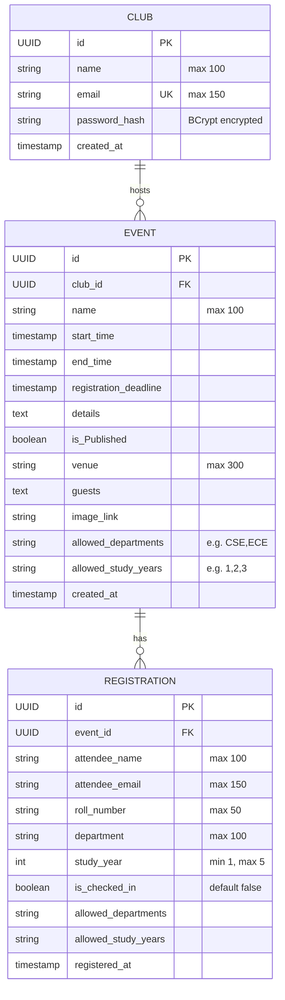
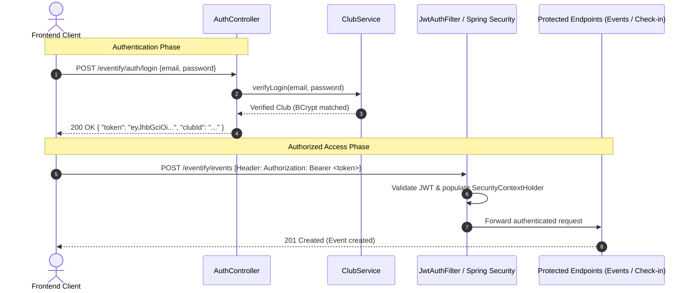

# Eventify 🎟️

Eventify is a robust backend REST API built with **Spring Boot** and **PostgreSQL**, designed to manage college/organization clubs, event publishing, attendee registrations, eligibility filtering, attendee check-ins, and secure club authentication using JWT.

---

## 📑 Table of Contents
- [Tech Stack](#tech-stack)
- [Architecture & Package Structure](#architecture--package-structure)
- [Entity-Relationship Diagram](#entity-relationship-diagram)
- [Database Configuration](#database-configuration)
- [2nd Part of Development: Authentication, Security & DTO Architecture](#2nd-part-of-development)
  - [1. Overview of 2nd Part Changes](#1-overview-of-2nd-part-changes)
  - [2. JWT Authentication & Filter Pipeline](#2-jwt-authentication--filter-pipeline)
  - [3. Password Encryption (BCrypt)](#3-password-encryption-bcrypt)
  - [4. Data Transfer Objects (DTO) Pattern](#4-data-transfer-objects-dto-pattern)
  - [5. Centralized Error Handling (`GlobalExceptionHandler`)](#5-centralized-error-handling-globalexceptionhandler)
  - [6. Route Authorization Matrix (Public vs Protected)](#6-route-authorization-matrix-public-vs-protected)
- [API Reference](#api-reference)
  - [Authentication Endpoints](#1-authentication-endpoints)
  - [Club Endpoints](#2-club-endpoints)
  - [Event Endpoints](#3-event-endpoints)
  - [Registration Endpoints](#4-registration-endpoints)
- [Eligibility & Validation Rules](#eligibility--validation-rules)
- [Getting Started & Testing with JWT](#getting-started--testing-with-jwt)

---

## 🛠️ Tech Stack

- **Java**: 27
- **Framework**: Spring Boot 4.x / Spring Data JPA / Spring MVC
- **Security**: Spring Security 6.x & `BCryptPasswordEncoder`
- **Authentication**: JJWT (Java JWT `io.jsonwebtoken:jjwt-api:0.12.6`, `jjwt-impl`, `jjwt-jackson`)
- **Database**: PostgreSQL
- **ORM / Persistence**: Hibernate / Jakarta Persistence (JPA)
- **Validation**: Jakarta Bean Validation (`hibernate-validator`)
- **Boilerplate Reduction**: Project Lombok
- **Build Tool**: Maven (`mvnw`)

---

## 📂 Architecture & Package Structure

The project follows a standard layered architecture under `me.geetprince.Eventify`:

```
src/main/java/me/geetprince/Eventify/
├── EventifyApplication.java           # Application entry point
├── config/
│   ├── CorsConfig.java                # Cross-Origin Resource Sharing configuration
│   ├── JwtAuthenticationFilter.java   # [Phase 2] Intercepts requests & validates Bearer tokens
│   └── SecurityConfig.java            # [Phase 2] Route security rules, filter order & BCrypt bean
├── controller/
│   ├── AuthController.java            # [Phase 2] REST endpoints for Club login & JWT issuance
│   ├── ClubController.java            # REST endpoints for Club registration & queries
│   ├── EventController.java           # REST endpoints for Event CRUD operations
│   └── RegistrationController.java    # REST endpoints for Registrations & Check-ins
├── dto/                               # [Phase 2] Data Transfer Objects
│   ├── ClubResponseDTO.java           # Sanitized Club data excluding sensitive password hashes
│   ├── ErrorResponse.java             # Standardized structured error response model
│   └── LoginRequest.java              # Request body schema for login credentials
├── exception/                         # [Phase 2] Centralized exception handling
│   └── GlobalExceptionHandler.java    # @ControllerAdvice transforming exceptions into standard responses
├── model/
│   ├── Club.java                      # Club JPA entity (organizers)
│   ├── Event.java                     # Event JPA entity (events hosted by clubs)
│   └── Registration.java              # Registration JPA entity (attendees)
├── repository/
│   ├── ClubRepository.java            # Spring Data JPA repository for Club
│   ├── EventRepository.java           # Spring Data JPA repository for Event
│   └── RegistrationRepository.java    # Spring Data JPA repository for Registration
├── service/
│   ├── ClubService.java               # Business logic, BCrypt hashing & credential verification
│   ├── EventService.java              # Business logic & queries for Events
│   └── RegistrationService.java       # Eligibility logic, registration & check-ins
└── util/                              # [Phase 2] Utility helpers
    └── JwtUtil.java                   # JWT creation, claims extraction & token validation
```

---

## 📊 Entity-Relationship Diagram



---

## ⚙️ Database Configuration

Configuration resides in [`src/main/resources/application.properties`](file:///Users/geet/projects/converting%20form%20py%20to%20java/Eventify/src/main/resources/application.properties):

```properties
spring.application.name=Eventify
spring.datasource.url=jdbc:postgresql://localhost:5432/eventify
spring.datasource.username=geet
spring.datasource.password=0
spring.datasource.driver-class-name=org.postgresql.Driver

spring.jpa.hibernate.ddl-auto=update
spring.jpa.show-sql=true
logging.level.org.springframework.security=DEBUG
```

Ensure your PostgreSQL instance is running with a database named `eventify`.

---

<a name="2nd-part-of-development"></a>
## 🚀 2nd Part of Development: Authentication, Security & DTO Architecture

In the **2nd Part of Development**, the application transitioned from an open prototype to an industry-grade, secure, multi-tenant REST API with token-based stateless authentication, password security, DTO data hygiene, and global exception interception.

### 1. Overview of 2nd Part Changes

| Area | Prior Implementation (Phase 1) | 2nd Part Implementation (Phase 2) |
|---|---|---|
| **Authentication** | None (All endpoints unprotected) | **Stateless JWT Authentication** with token signing, extraction, and validation |
| **Password Storage** | Plain text / unverified hashes | **BCrypt hashing** (`BCryptPasswordEncoder`) on club registration and matching on login |
| **Data Hygiene** | Raw JPA entities returned in API responses | **Data Transfer Objects (DTOs)** (`ClubResponseDTO`) masking sensitive fields like `passwordHash` |
| **Error Handling** | Scattered manual `try-catch` blocks in controllers | **Centralized `@ControllerAdvice`** (`GlobalExceptionHandler`) with standardized schema |
| **Route Security** | Blanket permit on `/eventify/**` | **Fine-grained RBAC**: Public event browsing & student registration; protected event management & check-in |
| **Club Operations** | Only `POST /register` | Added `GET /eventify/clubs/{id}` and `GET /eventify/clubs` returning sanitized DTOs |

---

### 2. JWT Authentication & Filter Pipeline

#### Token Generation & Specifications
- **Signing Algorithm**: HMAC-SHA256 (`HS256`) via JJWT (`io.jsonwebtoken:jjwt-api:0.12.6`).
- **Expiration**: 24 hours (`86,400,000` milliseconds).
- **Subject**: Club's unique email address.
- **Component**: [`JwtUtil.java`](file:///Users/geet/projects/converting%20form%20py%20to%20java/Eventify/src/main/java/me/geetprince/Eventify/util/JwtUtil.java).

#### Filter Chain Pipeline
1. Incoming requests pass through [`JwtAuthenticationFilter.java`](file:///Users/geet/projects/converting%20form%20py%20to%20java/Eventify/src/main/java/me/geetprince/Eventify/config/JwtAuthenticationFilter.java) (extending `OncePerRequestFilter`).
2. The filter inspects the HTTP `Authorization` header for `Bearer <token>`.
3. If present and valid, the club email is extracted from the JWT claims.
4. An authenticated `UsernamePasswordAuthenticationToken` is set into Spring's `SecurityContextHolder`.
5. If absent on protected routes, Spring Security blocks the request with `403 Forbidden` / `401 Unauthorized`.



---

### 3. Password Encryption (BCrypt)

- Registered [`PasswordEncoder`](file:///Users/geet/projects/converting%20form%20py%20to%20java/Eventify/src/main/java/me/geetprince/Eventify/config/SecurityConfig.java) bean using `BCryptPasswordEncoder`.
- **Registration**: When a club registers (`ClubService.registerClub`), the raw password is automatically encrypted using `passwordEncoder.encode(...)` before being persisted to PostgreSQL.
- **Login**: When logging in (`ClubService.verifyLogin`), raw input password is authenticated using `passwordEncoder.matches(...)`. Invalid credentials throw an `IllegalArgumentException("Invalid email or password.")`.

---

### 4. Data Transfer Objects (DTO) Pattern

To decouple database persistence models from API contracts and prevent data leakage:
- **`ClubResponseDTO`**:
  ```java
  public class ClubResponseDTO {
      private UUID id;
      private String name;
      private String email;
      // Sensitive fields like passwordHash are omitted
  }
  ```
- **`LoginRequest`**:
  ```java
  public class LoginRequest {
      private String email;
      private String password;
  }
  ```
- **`ErrorResponse`**:
  ```java
  public class ErrorResponse {
      private int status;
      private String error;
      private String message;
      private LocalDateTime timestamp;
  }
  ```

---

### 5. Centralized Error Handling (`GlobalExceptionHandler`)

Implemented via [`@ControllerAdvice`](file:///Users/geet/projects/converting%20form%20py%20to%20java/Eventify/src/main/java/me/geetprince/Eventify/exception/GlobalExceptionHandler.java):
- **`IllegalArgumentException`**: Automatically mapped to `400 Bad Request` with an `ErrorResponse` containing the domain failure message (e.g. duplicate email, ineligibility).
- **`Exception` (General fallback)**: Automatically mapped to `500 Internal Server Error` with a sanitized message preventing stack trace leaks.

Example error response:
```json
{
  "status": 400,
  "error": "Bad Request",
  "message": "A club with this email already exists.",
  "timestamp": "2026-11-05T06:25:30.123456"
}
```

---

### 6. Route Authorization Matrix (Public vs Protected)

| Method | Endpoint | Access Level | Description |
|---|---|---|---|
| `POST` | `/eventify/auth/login` | 🌐 **Public** | Authenticate club & issue JWT token |
| `POST` | `/eventify/clubs/register` | 🌐 **Public** | Register new club account (hashes password) |
| `GET` | `/eventify/clubs/{id}` | 🌐 **Public** | Fetch sanitized club profile |
| `GET` | `/eventify/clubs` | 🌐 **Public** | Fetch all registered clubs |
| `GET` | `/eventify/events` | 🌐 **Public** | List all events for attendees/public |
| `GET` | `/eventify/events/{id}` | 🌐 **Public** | View specific event details |
| `POST` | `/eventify/registrations` | 🌐 **Public** | Attendees register for an event |
| `POST` | `/eventify/events` | 🔒 **Protected** (Bearer JWT) | Create a new event (Clubs only) |
| `PUT` | `/eventify/events/{id}` | 🔒 **Protected** (Bearer JWT) | Update an event (Clubs only) |
| `GET` | `/eventify/registrations/event/{eventId}` | 🔒 **Protected** (Bearer JWT) | View attendee list for an event |
| `PUT` | `/eventify/registrations/{id}/checkin` | 🔒 **Protected** (Bearer JWT) | Check in an attendee at event entry |

---

## 🚀 API Reference

Base URL: `http://localhost:8080`

### 1. Authentication Endpoints

#### Club Login
* **Method & URL**: `POST /eventify/auth/login`
* **Access**: Public
* **Description**: Authenticates a club using email and password, returning a 24-hour signed JWT and the club ID.
* **Request Body**:
```json
{
  "email": "codingclub@university.edu",
  "password": "SecurePassword123!"
}
```
* **Success Response**: `200 OK`
```json
{
  "token": "eyJhbGciOiJIUzI1NiJ9.eyJzdWIiOiJjb2RpbmdjbHViQHVuaXZlcnNpdHkuZWR1IiwiaWF0IjoxNzYzMTk2MDAwLCJleHAiOjE3NjMyODI0MDB9...",
  "clubId": "e6f4a86b-a25e-4c74-8dbb-91d9b32c63df"
}
```
* **Error Response**: `401 Unauthorized`
```text
Invalid email or password.
```

---

### 2. Club Endpoints

#### Register a Club
* **Method & URL**: `POST /eventify/clubs/register`
* **Access**: Public
* **Description**: Registers a new club. Encrypts the raw password with BCrypt and returns the sanitized `ClubResponseDTO`.
* **Request Body**:
```json
{
  "name": "Robotics Club",
  "email": "robotics@university.edu",
  "passwordHash": "MySecretPass!2026"
}
```
* **Success Response**: `201 Created`
```json
{
  "id": "7b8d424b-324e-4b62-959c-7cf05efbe41e",
  "name": "Robotics Club",
  "email": "robotics@university.edu"
}
```
* **Error Response**: `400 Bad Request` (via `GlobalExceptionHandler`)
```json
{
  "status": 400,
  "error": "Bad Request",
  "message": "A club with this email already exists.",
  "timestamp": "2026-11-05T06:20:00"
}
```

#### Get Club by ID
* **Method & URL**: `GET /eventify/clubs/{id}`
* **Access**: Public
* **Path Variables**: `id` (UUID)
* **Success Response**: `200 OK`
```json
{
  "id": "7b8d424b-324e-4b62-959c-7cf05efbe41e",
  "name": "Robotics Club",
  "email": "robotics@university.edu"
}
```
* **Error Response**: `404 Not Found`

#### Get All Clubs
* **Method & URL**: `GET /eventify/clubs`
* **Access**: Public
* **Success Response**: `200 OK`
```json
[
  {
    "id": "7b8d424b-324e-4b62-959c-7cf05efbe41e",
    "name": "Robotics Club",
    "email": "robotics@university.edu"
  }
]
```

---

### 3. Event Endpoints

#### Create an Event
* **Method & URL**: `POST /eventify/events`
* **Access**: 🔒 **Protected** (Requires `Authorization: Bearer <jwt_token>`)
* **Request Body**:
```json
{
  "name": "Annual Hackathon 2026",
  "club": {
    "id": "7b8d424b-324e-4b62-959c-7cf05efbe41e"
  },
  "startTime": "2026-12-10T10:00:00Z",
  "endTime": "2026-12-11T18:00:00Z",
  "registrationDeadline": "2026-12-05T23:59:59Z",
  "details": "24-hour coding marathon building real-world solutions.",
  "public": true,
  "venue": "Campus Auditorium & Labs",
  "guests": "Dr. Tech, Industry Experts",
  "imageLink": "https://example.com/banner.jpg",
  "allowedDepartments": "CSE,IT,ECE",
  "allowedStudyYears": "2,3,4"
}
```
* **Success Response**: `201 Created` with saved Event object.
* **Error Response**: `403 Forbidden` if Authorization header is missing or token is invalid.

#### Get All Events
* **Method & URL**: `GET /eventify/events`
* **Access**: 🌐 Public
* **Success Response**: `200 OK` with list of events.

#### Get Event by ID
* **Method & URL**: `GET /eventify/events/{id}`
* **Access**: 🌐 Public
* **Path Variables**: `id` (UUID)
* **Success Response**: `200 OK` with Event details.
* **Error Response**: `404 Not Found`.

#### Update Event
* **Method & URL**: `PUT /eventify/events/{id}`
* **Access**: 🔒 **Protected** (Requires `Authorization: Bearer <jwt_token>`)
* **Request Body**: JSON with updated event fields.
* **Success Response**: `200 OK` with updated Event.

---

### 4. Registration Endpoints

#### Register Attendee for an Event
* **Method & URL**: `POST /eventify/registrations`
* **Access**: 🌐 Public
* **Description**: Registers an attendee. Validates student department and year against event rules, and blocks duplicate registrations.
* **Request Body**:
```json
{
  "event": {
    "id": "4a737f22-2615-4ba8-be9c-7bfaf565ecbe"
  },
  "attendeeName": "Alex Johnson",
  "attendeeEmail": "alex.johnson@university.edu",
  "rollNumber": "CS2023045",
  "department": "CSE",
  "studyYear": 3
}
```
* **Success Response**: `201 Created`
```json
{
  "id": "c86e082d-2092-4fcf-847d-8ebff82895ea",
  "attendeeName": "Alex Johnson",
  "attendeeEmail": "alex.johnson@university.edu",
  "rollNumber": "CS2023045",
  "department": "CSE",
  "studyYear": 3,
  "checkedIn": false,
  "registeredAt": "2026-11-05T04:40:00Z"
}
```
* **Error Responses** (`400 Bad Request`):
  - `"Your department is not eligible for this event."`
  - `"Your study year is not eligible for this event."`
  - `"Already registered for this event."`
  - `"Event not found."`

#### Get All Registrations for an Event
* **Method & URL**: `GET /eventify/registrations/event/{eventId}`
* **Access**: 🔒 **Protected** (Requires `Authorization: Bearer <jwt_token>`)
* **Path Variables**: `eventId` (UUID)
* **Success Response**: `200 OK` with list of registrations.

#### Check-in Attendee
* **Method & URL**: `PUT /eventify/registrations/{id}/checkin`
* **Access**: 🔒 **Protected** (Requires `Authorization: Bearer <jwt_token>`)
* **Path Variables**: `id` (UUID)
* **Success Response**: `200 OK` with updated registration (`checkedIn = true`).
* **Error Response**: `404 Not Found` if registration ID does not exist.

---

## 🔒 Eligibility & Validation Rules

1. **Department Restriction (`allowedDepartments`)**:
   - If populated on the event (e.g. `"CSE,IT"`), registration verifies the student's department against this comma-delimited list (case-insensitive).
   - Ineligible departments receive `400 Bad Request`.
2. **Study Year Restriction (`allowedStudyYears`)**:
   - If populated on the event (e.g. `"2,3"`), registration checks `studyYear`.
   - Ineligible years receive `400 Bad Request`.
3. **Duplicate Prevention**:
   - Each attendee email can only register once per event (`existsByEvent_IdAndAttendeeEmail`).
4. **Validation Constraints**:
   - Attendee study year must be between `1` and `5` (`@Min(1)`, `@Max(5)`).

---

## 💻 Getting Started & Testing with JWT

### 1. Prerequisites
- Java 27 SDK installed
- PostgreSQL running on port 5432 with database `eventify`
- Maven (`./mvnw`)

### 2. Run the Application
```bash
./mvnw clean spring-boot:run
```

### 3. Testing the Secure Flow

1. **Register a Club**:
   ```bash
   curl -X POST http://localhost:8080/eventify/clubs/register \
     -H "Content-Type: application/json" \
     -d '{"name": "Tech Club", "email": "tech@club.com", "passwordHash": "pass123"}'
   ```

2. **Login to Obtain JWT**:
   ```bash
   curl -X POST http://localhost:8080/eventify/auth/login \
     -H "Content-Type: application/json" \
     -d '{"email": "tech@club.com", "password": "pass123"}'
   ```
   *Response contains `{ "token": "<JWT_TOKEN>", "clubId": "..." }`.*

3. **Access Protected Endpoints (Create Event)**:
   ```bash
   curl -X POST http://localhost:8080/eventify/events \
     -H "Content-Type: application/json" \
     -H "Authorization: Bearer <JWT_TOKEN>" \
     -d '{
       "name": "AI Summit",
       "club": {"id": "<CLUB_ID>"},
       "startTime": "2026-11-20T10:00:00Z",
       "endTime": "2026-11-20T16:00:00Z",
       "registrationDeadline": "2026-11-18T23:59:59Z",
       "venue": "Hall A",
       "allowedDepartments": "CSE,ECE",
       "allowedStudyYears": "2,3"
     }'
   ```
