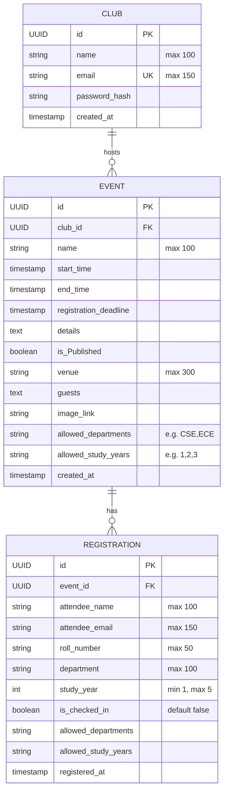

# Eventify 🎟️

Eventify is a robust backend REST API built with **Spring Boot** and **PostgreSQL**, designed to manage college/organization clubs, event publishing, attendee registrations, eligibility filtering, and attendee check-ins.

---

## 📑 Table of Contents
- [Tech Stack](#tech-stack)
- [Architecture & Package Structure](#architecture--package-structure)
- [Entity-Relationship Diagram](#entity-relationship-diagram)
- [Database Configuration](#database-configuration)
- [API Reference](#api-reference)
  - [Club Endpoints](#1-club-endpoints)
  - [Event Endpoints](#2-event-endpoints)
  - [Registration Endpoints](#3-registration-endpoints)
- [Eligibility & Validation Rules](#eligibility--validation-rules)
- [Getting Started](#getting-started)
- [CORS & Security Configuration](#cors--security-configuration)

---

## 🛠️ Tech Stack

- **Java**: 27
- **Framework**: Spring Boot 4.x / Spring Data JPA / Spring MVC
- **Security**: Spring Security 6.x
- **Database**: PostgreSQL
- **ORM / Persistence**: Hibernate / Jakarta Persistence (JPA)
- **Validation**: Jakarta Bean Validation (`hibernate-validator`)
- **Boilerplate Reduction**: Project Lombok
- **Build Tool**: Maven (`mvnw`)

---

## 📂 Architecture & Package Structure

The project follows a standard layered architecture under `me.geetprince.Eventify`:

```
src/main/java/me/geetprince/Eventify/
├── EventifyApplication.java           # Application entry point
├── config/
│   ├── CorsConfig.java                # Cross-Origin Resource Sharing configuration
│   └── SecurityConfig.java            # Spring Security authorization & filter chains
├── controller/
│   ├── ClubController.java            # REST endpoints for Club operations
│   ├── EventController.java           # REST endpoints for Event CRUD operations
│   └── RegistrationController.java    # REST endpoints for Registrations & Check-ins
├── model/
│   ├── Club.java                      # Club JPA entity (organizers)
│   ├── Event.java                     # Event JPA entity (events hosted by clubs)
│   └── Registration.java              # Registration JPA entity (attendees)
├── repository/
│   ├── ClubRepository.java            # Spring Data JPA repository for Club
│   ├── EventRepository.java           # Spring Data JPA repository for Event
│   └── RegistrationRepository.java    # Spring Data JPA repository for Registration
└── service/
    ├── ClubService.java               # Business logic & validations for Clubs
    ├── EventService.java              # Business logic & queries for Events
    └── RegistrationService.java       # Eligibility logic, registration & check-ins
```

---

## 📊 Entity-Relationship Diagram



---

## ⚙️ Database Configuration

Configuration resides in [`src/main/resources/application.properties`](file:///Users/geet/projects/converting%20form%20py%20to%20java/Eventify/src/main/resources/application.properties):

```properties
spring.application.name=Eventify
spring.datasource.url=jdbc:postgresql://localhost:5432/eventify
spring.datasource.username=geet
spring.datasource.password=0
spring.datasource.driver-class-name=org.postgresql.Driver

spring.jpa.hibernate.ddl-auto=update
spring.jpa.show-sql=true
logging.level.org.springframework.security=DEBUG
```

Ensure your PostgreSQL instance is running with a database named `eventify`.

---

## 🚀 API Reference

Base URL: `http://localhost:8080`

### 1. Club Endpoints

#### Register a Club
* **Method & URL**: `POST /eventify/clubs/register`
* **Description**: Registers a new club organizer account. Checks for existing email.
* **Request Body**:
```json
{
  "name": "Coding Club",
  "email": "codingclub@university.edu",
  "passwordHash": "$2a$10$hashed_password_example"
}
```
* **Success Response**: `201 Created`
```json
{
  "id": "e6f4a86b-a25e-4c74-8dbb-91d9b32c63df",
  "name": "Coding Club",
  "email": "codingclub@university.edu",
  "passwordHash": "$2a$10$hashed_password_example",
  "createdAt": "2026-11-05T04:30:00Z"
}
```
* **Error Response**: `400 Bad Request` if a club with the same email already exists.

---

### 2. Event Endpoints

#### Create an Event
* **Method & URL**: `POST /eventify/events`
* **Description**: Creates a new event under an existing club.
* **Request Body**:
```json
{
  "name": "Annual Hackathon 2026",
  "club": {
    "id": "e6f4a86b-a25e-4c74-8dbb-91d9b32c63df"
  },
  "startTime": "2026-12-10T10:00:00Z",
  "endTime": "2026-12-11T18:00:00Z",
  "registrationDeadline": "2026-12-05T23:59:59Z",
  "details": "24-hour coding marathon building real-world solutions.",
  "public": true,
  "venue": "Campus Auditorium & Labs",
  "guests": "Dr. Tech, Industry Experts",
  "imageLink": "https://example.com/banner.jpg",
  "allowedDepartments": "CSE,IT,ECE",
  "allowedStudyYears": "2,3,4"
}
```
* **Success Response**: `201 Created` with the saved event object (including generated `id` and `createdAt`).

#### Get All Events
* **Method & URL**: `GET /eventify/events`
* **Description**: Retrieves a list of all events.
* **Success Response**: `200 OK`
```json
[
  {
    "id": "4a737f22-2615-4ba8-be9c-7bfaf565ecbe",
    "name": "Annual Hackathon 2026",
    "startTime": "2026-12-10T10:00:00Z",
    "endTime": "2026-12-11T18:00:00Z",
    "registrationDeadline": "2026-12-05T23:59:59Z",
    "details": "24-hour coding marathon building real-world solutions.",
    "public": true,
    "venue": "Campus Auditorium & Labs",
    "guests": "Dr. Tech, Industry Experts",
    "imageLink": "https://example.com/banner.jpg",
    "allowedDepartments": "CSE,IT,ECE",
    "allowedStudyYears": "2,3,4",
    "createdAt": "2026-11-05T04:35:00Z"
  }
]
```

#### Get Event by ID
* **Method & URL**: `GET /eventify/events/{id}`
* **Description**: Retrieves event details by UUID.
* **Path Variables**: `id` (UUID) - Event ID
* **Success Response**: `200 OK` with Event details.
* **Error Response**: `404 Not Found` if event doesn't exist.

#### Update Event
* **Method & URL**: `PUT /eventify/events/{id}`
* **Description**: Updates event metadata, timing, eligibility rules, and details.
* **Path Variables**: `id` (UUID) - Event ID
* **Request Body**:
```json
{
  "name": "Annual Hackathon 2026 (Updated)",
  "startTime": "2026-12-10T09:00:00Z",
  "endTime": "2026-12-11T18:00:00Z",
  "registrationDeadline": "2026-12-06T23:59:59Z",
  "details": "Updated details with new sponsor prizes.",
  "public": true,
  "venue": "Main Auditorium",
  "guests": "Keynote Speakers",
  "imageLink": "https://example.com/banner-updated.jpg",
  "allowedDepartments": "CSE,IT,ECE,MECH",
  "allowedStudyYears": "1,2,3,4"
}
```
* **Success Response**: `200 OK` with updated Event.
* **Error Response**: `404 Not Found` if event doesn't exist.

---

### 3. Registration Endpoints

#### Register Attendee for an Event
* **Method & URL**: `POST /eventify/registrations`
* **Description**: Registers a student/attendee for an event with strict eligibility checks.
* **Request Body**:
```json
{
  "event": {
    "id": "4a737f22-2615-4ba8-be9c-7bfaf565ecbe"
  },
  "attendeeName": "Alex Johnson",
  "attendeeEmail": "alex.johnson@university.edu",
  "rollNumber": "CS2023045",
  "department": "CSE",
  "studyYear": 3
}
```
* **Success Response**: `201 Created`
```json
{
  "id": "c86e082d-2092-4fcf-847d-8ebff82895ea",
  "attendeeName": "Alex Johnson",
  "attendeeEmail": "alex.johnson@university.edu",
  "rollNumber": "CS2023045",
  "department": "CSE",
  "studyYear": 3,
  "checkedIn": false,
  "registeredAt": "2026-11-05T04:40:00Z"
}
```
* **Error Responses**:
  - `400 Bad Request`: `"Event not found."`
  - `400 Bad Request`: `"Your department is not eligible for this event."`
  - `400 Bad Request`: `"Your study year is not eligible for this event."`
  - `400 Bad Request`: `"Already registered for this event."`

#### Get All Registrations for an Event
* **Method & URL**: `GET /eventify/registrations/event/{eventId}`
* **Description**: Lists all attendees registered for a specific event.
* **Path Variables**: `eventId` (UUID) - Target event ID
* **Success Response**: `200 OK`
```json
[
  {
    "id": "c86e082d-2092-4fcf-847d-8ebff82895ea",
    "attendeeName": "Alex Johnson",
    "attendeeEmail": "alex.johnson@university.edu",
    "rollNumber": "CS2023045",
    "department": "CSE",
    "studyYear": 3,
    "checkedIn": false,
    "registeredAt": "2026-11-05T04:40:00Z"
  }
]
```

#### Check-in Attendee
* **Method & URL**: `PUT /eventify/registrations/{id}/checkin`
* **Description**: Marks an attendee as checked-in (`checkedIn = true`) at the event venue.
* **Path Variables**: `id` (UUID) - Registration ID
* **Success Response**: `200 OK`
```json
{
  "id": "c86e082d-2092-4fcf-847d-8ebff82895ea",
  "attendeeName": "Alex Johnson",
  "attendeeEmail": "alex.johnson@university.edu",
  "rollNumber": "CS2023045",
  "department": "CSE",
  "studyYear": 3,
  "checkedIn": true,
  "registeredAt": "2026-11-05T04:40:00Z"
}
```
* **Error Response**: `404 Not Found`: `"Registration not found."`

---

## 🔒 Eligibility & Validation Rules

1. **Department Restriction (`allowedDepartments`)**:
   - If populated on the event (e.g. `"CSE,IT"`), registration verifies the student's department against this comma-delimited list (case-insensitive).
   - Non-matching departments are rejected with `400 Bad Request`.
2. **Study Year Restriction (`allowedStudyYears`)**:
   - If populated on the event (e.g. `"2,3"`), registration checks `studyYear` (between 1 and 5).
   - Ineligible years are rejected with `400 Bad Request`.
3. **Duplicate Prevention**:
   - Each attendee email can only register once per event (`existsByEvent_IdAndAttendeeEmail`).
4. **Validation Constraints**:
   - Attendee study year must be between `1` and `5` (`@Min(1)`, `@Max(5)`).

---

## 🌐 CORS & Security Configuration

- **Permitted Paths**: `/eventify/**` and `/error` are configured to permit unauthenticated access via `SecurityConfig`.
- **CORS Allowed Origins**: `http://localhost:3000` (React default) and `http://localhost:5173` (Vite default).
- **HTTP Methods Supported**: `GET`, `POST`, `PUT`, `DELETE`, `OPTIONS`.

---

## 💻 Getting Started

### Prerequisites
- Java 27 SDK installed
- PostgreSQL installed and running on port 5432
- Maven (or use the included wrapper `./mvnw`)

### Build and Run

1. **Clone the repository**:
   ```bash
   git clone https://github.com/Geet-Prince/eventify.git
   cd eventify
   ```

2. **Configure Database**:
   Verify or update database credentials in `src/main/resources/application.properties`.

3. **Compile and Run**:
   ```bash
   ./mvnw clean spring-boot:run
   ```

4. **Package Application**:
   ```bash
   ./mvnw clean package
   ```
